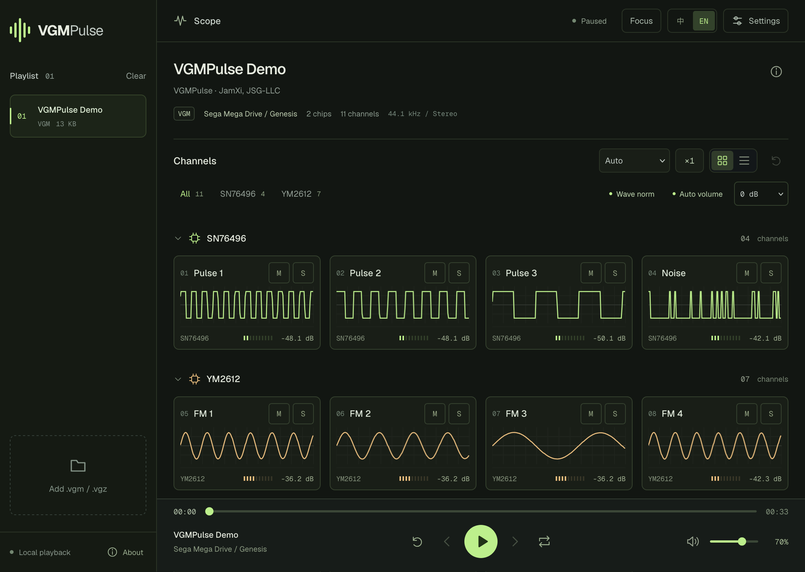

# VGMPulse

VGM / VGZ 芯片音乐播放器，音乐文件在本地解码。



- 逐通道波形、电平、芯片及通道名称
- 播放列表、进度定位、循环、静音与独奏
- 波形与音量规格化、增益调节
- 手机适配、显示密度设置、中英文切换

## 本地运行

需要 Node.js 22.13 或更新版本。

```sh
npm install
npm run dev
```

构建：`npm run build`。

## 版权与许可

Copyright © 2017–2026 JamXi, JSG-LLC.

采用 [GNU GPL v3.0](LICENSE)（GPL-3.0-only）许可。

音频核心来自 [Chip Player JS](https://github.com/mmontag/chip-player-js)，使用 [LibVGM](https://github.com/ValleyBell/libvgm)。第三方组件保留各自的版权与许可，详见 [第三方声明](public/THIRD_PARTY_NOTICES.txt) 和 [音频核心来源](public/engine/NOTICE.txt)。
